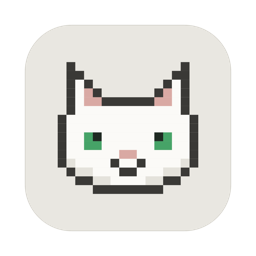

<div align="center">



# Tobias

**Find the caches, logs and build output eating your Mac's disk, and clear them in one click.**


[Install](#install) · [What it cleans](#what-it-cleans) · [Safety](#safety) · [Custom targets](#add-your-own-targets) · [Develop](#develop)

</div>

---

Tobias is a small native Mac app. It scans on a schedule, shows how much space you can reclaim, and never deletes anything without your confirmation.

> [!WARNING]
> **Tobias deletes files.** Deletion is permanent: nothing goes to the Trash. Every target is listed in [`catalog.json`](Sources/TobiasCore/Resources/catalog.json), previewed before it runs, and limited by the rules in [docs/SAFETY.md](docs/SAFETY.md). Read the preview before you confirm.

## Highlights

- **Scans automatically** at launch and every 6 hours, across a catalog of known developer and app caches.
- **Finds leftovers** in `~/Library/Caches` and `~/Library/Logs`: folders of 20 MB or more that the catalog does not list, flagged when their app is no longer installed.
- **Previews first**, showing free space, the size of each target, and whether it is rebuilt automatically or downloaded again.
- **Uses each tool's own cleanup** command when it has one, instead of deleting its folders.
- **Respects running apps** by blocking a target while its app is open and offering to quit the app.
- **Keeps an audit log**: an append-only record of everything it removed.

## Install

**Requirements:** macOS 14 or newer and the Xcode Command Line Tools (`xcode-select --install`). You don't need Xcode or a clone of this repo.

```bash
curl -fsSL https://github.com/andreyabpaiva/tobias/releases/latest/download/install.sh | bash
```

The script downloads the latest release, verifies its SHA-256, builds it on your Mac, then installs `Tobias.app` to `~/Applications` and the `tobias` command to `~/.local/bin`. It never uses sudo.

<details>
<summary>Prefer to read the script first?</summary>

```bash
curl -fsSL -o install.sh https://github.com/OWNER/tobias/releases/latest/download/install.sh
less install.sh
bash install.sh
```

</details>

<details>
<summary><code>tobias: command not found</code>?</summary>

Add `~/.local/bin` to your PATH:

```bash
echo 'export PATH="$HOME/.local/bin:$PATH"' >> ~/.zshrc
```

</details>

### Commands

| Command | What it does |
|---|---|
| `tobias update` | Installs the latest release if it is newer |
| `tobias uninstall` | Removes the app, the login item and the command (keeps your data) |
| `tobias purge` | Also deletes scan history and the audit log |
| `tobias version` | Prints the installed version |
| `tobias doctor` | Checks the toolchain and install locations |

## What it cleans

- **Package manager caches** for common JavaScript, Python, Go and Homebrew tooling
- **Build output** from Xcode and other build tools
- **App caches** for editors, browsers and desktop apps
- **Downloaded runtimes and assets** such as test browsers, emulator images and ML models
- **Logs**, including system logs (shown as a command to copy, since they are root-owned)
- **Leftovers** from apps you have removed, found by scanning your cache and log folders

Each target is labeled as either rebuilt automatically or downloaded again on next use. Leftovers are never selected by default. The full list is in [`catalog.json`](Sources/TobiasCore/Resources/catalog.json).

> [!NOTE]
> After cleaning, System Settings can keep showing the old *System Data* figure until you restart. The free space shown in Tobias is the accurate number.

## Safety

- Nothing is deleted without a preview and your confirmation.
- Wildcards over shared folders (such as `~/Library/Caches/*`) are rejected.
- It never runs `sudo`. Root-owned files show a command for you to copy instead.
- It never touches Photos, Mail or Messages.

The full rules are in [docs/SAFETY.md](docs/SAFETY.md).

### Permissions

Most targets live in places any app can read. If a path shows as *Blocked*, grant Tobias **Full Disk Access** in **System Settings → Privacy & Security**.

## Add your own targets

Create `~/Library/Application Support/Tobias/targets.json`. An entry with the same `id` as a built-in target replaces it. Unsafe entries are rejected when the file loads.

```json
[
  {
    "id": "my-next-cache",
    "label": "My app build cache",
    "note": "Rebuilt by next build.",
    "paths": ["~/code/my-app/.next"],
    "action": "removeContents",
    "risk": "regenerates"
  },
  {
    "id": "big-vendor-log",
    "label": "Vendor daemon log",
    "paths": ["/private/var/log/vendor_daemon.log"],
    "action": "manual",
    "manualCommand": "sudo truncate -s 0 /private/var/log/vendor_daemon.log"
  }
]
```

| `action` | Behavior |
|---|---|
| `removeContents` | Deletes what is inside the folder |
| `command` | Runs the fixed shell command you set in `command` |
| `manual` | Shows `manualCommand` for you to copy |

> [!CAUTION]
> A `command` target runs in your login shell, so only add commands you would type yourself.

## Develop

```bash
make test              # unit tests (work with the Command Line Tools alone)
make scan              # read-only table of sizes, no window
make run               # run the app
scripts/build-app.sh   # build build/Tobias.app
```

```
Sources/
├── TobiasCore/   UI-free engine: catalog, scanner, safety rules, executor, store
└── Tobias/       SwiftUI app
```

More detail: [Architecture](docs/ARCHITECTURE.md) · [Sequence diagrams](docs/SEQUENCES.md) · [Design brief](docs/DESIGN_BRIEF.md)

### Releasing

1. Update `VERSION`.
2. Tag the commit `vX.Y.Z` and push the tag.
3. The release workflow checks that `VERSION` matches the tag, runs the tests, then publishes the source tarball, its checksum and `install.sh`.

## License

[MIT](LICENSE) © Andreya Paiva

The bundled Patrick Hand font is © Patrick Wagesreiter, licensed under the [SIL Open Font License 1.1](Sources/Tobias/Resources/Fonts/PatrickHand-OFL.txt).
