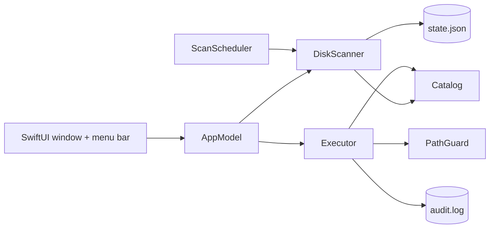

# Architecture

Tobias is a SwiftPM package with two targets: `TobiasCore` (no UI, fully tested) and `Tobias` (SwiftUI presentation only). There is no server and no network code in the app.

## Components

| Component | Responsibility |
|---|---|
| `Catalog` | Loads `catalog.json` (bundled) and `targets.json` (user), merges by `id`, rejects invalid entries |
| `PathGuard` | The only authority on what may be deleted (see SAFETY.md) |
| `CacheDiscovery` / `AppIndex` | Lists per-app folders in `Library/Caches` and `Library/Logs`, checks them against the installed apps (Info.plist of every app, Spotlight as a fallback for bundle ids) and turns them into ordinary targets |
| `DiskScanner` | Read-only size measurement: allocated bytes, symlinks skipped, one device, hard links counted once, per-target timeout, bounded concurrency |
| `DiskSpace` | Free space of the Data volume, both the Finder figure and the `df` figure |
| `Executor` | Preview, then run: delete a folder's contents, or run a fixed command, with running-app check and audit |
| `Store` | `state.json` (last scan, history capped at 200) and `audit.log`, atomic writes |
| `AppModel` | Observable state for the UI: rows, selection, clean phases, restart notice |
| `ScanScheduler` | Periodic scan through `NSBackgroundActivityScheduler` |

## Data model

A `Target` has `id`, `label`, `note`, `paths[]` (globs and `~` allowed), `action` (`removeContents`, `command`, `manual`), `command`, `manualCommand`, `quitApps[]` (bundle ids), and `risk` (`regenerates` or `redownloads`).

State lives in `~/Library/Application Support/Tobias/` (override with `TOBIAS_HOME`): `state.json`, `audit.log`, optional `targets.json`.

## Behavior

- **Discovery**: each scan first enumerates the direct children of `~/Library/Caches` and `~/Library/Logs`, skips `com.apple.*`, hidden and symlinked folders and anything a catalog target already covers, measures the rest and keeps those of 20 MB or more. Status per folder: *installed* (a matching app exists), *app removed* (a bundle-id folder with no installed app) or *no matching app* (a plain name such as `zen` with no app of that name or vendor). Leftovers are never pre-selected.
- **Scan**: at launch, then every 6 hours (configurable: 1, 3, 6, 12, 24). A path that returns `EPERM` is reported as blocked, never retried with elevation.
- **Clean**: select, preview, confirm, run. Targets whose app is running are blocked. After a successful clean the restart notice is shown, because the System Data figure in System Settings only recalculates after a restart.
- **Commands** run through `/bin/zsh -ilc` so nvm and Homebrew paths resolve, with a 5 minute timeout.

## Packaging

`scripts/build-app.sh` builds in release mode, assembles `Tobias.app` by hand (only the Command Line Tools are needed), copies SwiftPM resource bundles into `Contents/Resources` and signs ad hoc. `install.sh` and `bin/tobias` handle install, update and removal; see SEQUENCES.md.
