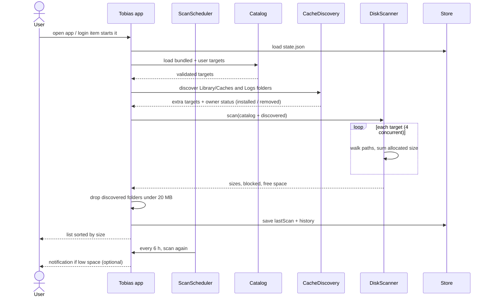
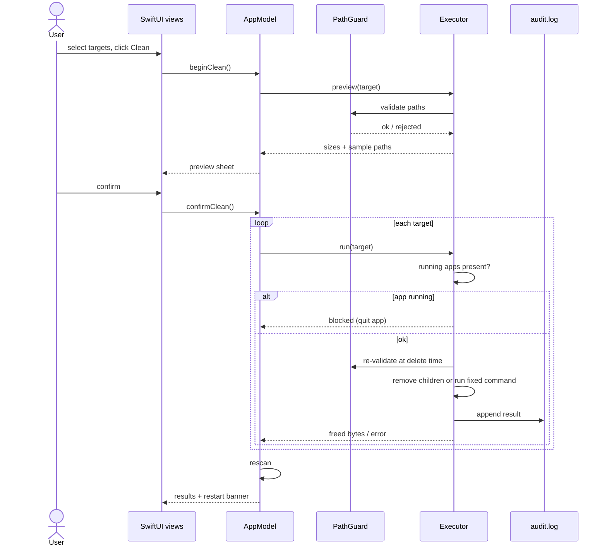
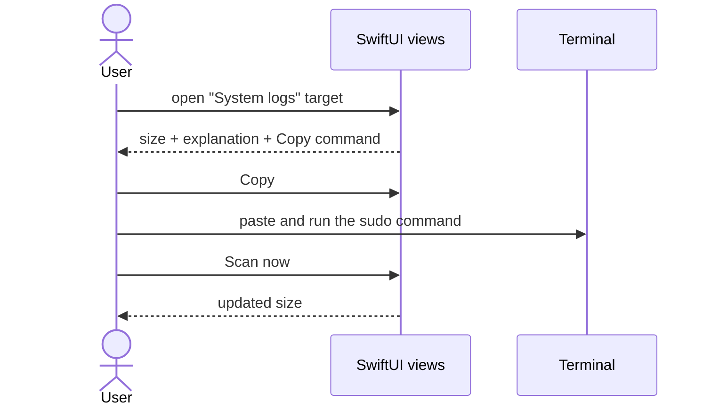
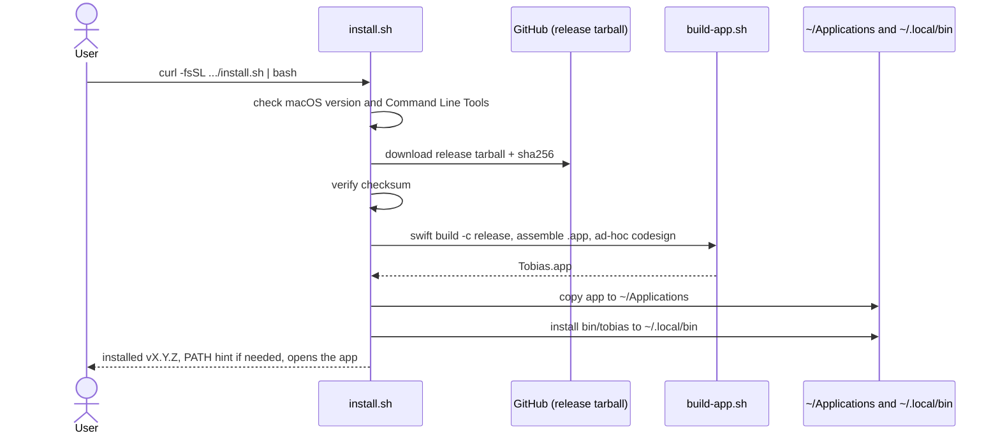

# Tobias: sequence diagrams

## 1. Launch and scheduled scan



## 2. Preview and clean



## 3. Manual (root) target



## 4. First install (no clone)



## 5. Update and uninstall

```mermaid
sequenceDiagram
  actor U as User
  participant CLI as tobias CLI
  participant GH as GitHub API
  participant FS as ~/Applications
  U->>CLI: tobias update
  CLI->>GH: latest release tag
  GH-->>CLI: tag
  alt tag equals installed version
    CLI-->>U: already up to date
  else newer
    CLI->>GH: fetch install.sh for that tag
    CLI->>CLI: run installer (download, verify, build)
    CLI->>FS: quit app, replace bundle, relaunch
    CLI-->>U: updated old to new
  end
  U->>CLI: tobias uninstall
  CLI->>FS: quit app, unregister login item, remove bundle, remove CLI
  CLI-->>U: removed (data kept; tobias purge deletes it)
```
